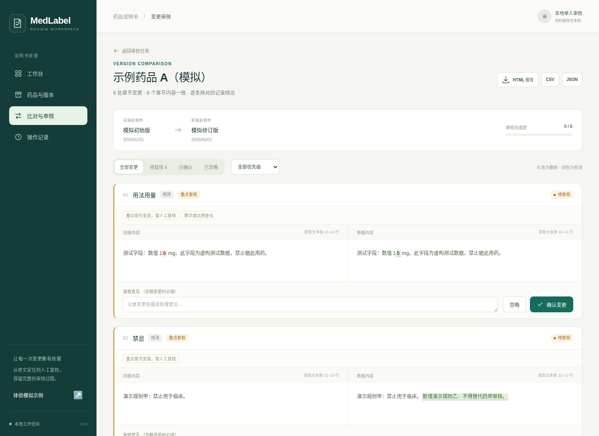

# MedLabel Review

**药品说明书版本比对与变更审核系统 V1.0**

面向药学资料整理、说明书变更核查和个人项目演示的本地网页应用。将同一药品的说明书按章节比对，突出新增、删除及修改，逐项记录人工确认或忽略原因，导出带来源与审核状态的报告。



## 运行

需要 Python 3.11 或更新版本。无需 Node.js 构建、数据库服务或大模型 API。

```bash
python -m venv .venv
# macOS / Linux
source .venv/bin/activate
# Windows PowerShell: .venv\Scripts\Activate.ps1
python -m pip install -r requirements.txt
python run.py
```

浏览器打开 **http://127.0.0.1:8000**。也可运行 `bash scripts/start.sh` 或 PowerShell 下运行 `scripts/start.ps1`。首次安装依赖需要联网；依赖安装后，应用无需外部网络即可处理本地文件。

在首页选择“载入演示数据”，即可体验两个**虚构药品说明书版本**的完整比对、审核与导出流程。演示文本不提供真实药物的用法用量。

## 功能

- 药品档案：名称、厂家、规格、批准文号、备注。
- 版本导入：纯文字 PDF（不含图片）、DOCX、TXT 或直接粘贴文本，保存原始文件、来源、版本日期及 SHA-256。
- 章节识别：中文说明书标题匹配、重复章节保留；未创建比对前可人工校正章节。
- 版本比对：同一药品的新旧版本、章节新增/删除/修改、数字与单位相关变化提示、原文位置定位。
- 人工审核：待审核、已确认、已忽略；忽略必须写明原因，保存审核记录，防止并发覆盖。
- 报告导出：独立 HTML、CSV、JSON；HTML 可在浏览器打印为 PDF。
- 操作日志：记录档案创建、版本上传、章节校正、比对建立与审核变更。

## 使用边界

V1.0 是**单机、单一可信操作者**版本，没有账户登录或多人权限隔离。审核员名称是本地显示名，不构成身份认证；不要直接暴露到公网。默认仅监听 `127.0.0.1`。

系统辅助发现文本变化；重点提示属于审核优先级，不表示临床风险评估或监管审批结论。首版保守拒绝含图片的 PDF（包括扫描件、带图片页眉或标志的 PDF），防止仅提取页码而遗漏正文。请先使用外部工具转换为完整的 TXT / DOCX，并人工核查。暂不处理 DOC、图片或复杂版式的可靠复原。自动章节提取和数字/单位提示可能遗漏，应结合原文复核。

上传文件最大 10MB，PDF 最大 100 页。第三方内容请使用合法获取的文件。仓库只包含模拟样例，运行产生的文件和数据库存于 `data/`，不纳入 Git。

## 配置与保存

```bash
python run.py --port 8001 --data-dir /path/to/medlabel-data
```

环境变量 `MEDLABEL_DATA_DIR` 用于直接启动 `uvicorn app.main:app` 时指定数据目录；`MEDLABEL_REVIEWER` 设置日志中的本地审核员显示名，默认“本地审核员”。

主机校验默认允许 `localhost`、`127.0.0.1` 和 `::1`。如需经自有反向代理访问，可用 `MEDLABEL_ALLOWED_HOSTS` 追加逗号分隔的主机名；这不会添加身份验证，代理层仍需自行配置访问控制。

备份时先停止应用，完整复制数据目录（数据库和附件必须一起保存）。恢复到另一目录后，用 `--data-dir` 指定它。已有比对引用的章节不能修改，发现解析错误应导入校正后的新版本并重新建立比对，以保留旧审核依据。

## 开发与验证

```bash
python -m pip install -r requirements-dev.txt
python -m pytest
node --check app/static/app.js
```

测试覆盖文档解析、数字变化、章节对齐、审核状态、来源保留、CSV 公式注入防护和主要 API 工作流。浏览器验收与截图方法见 `scripts/browser_smoke.py`（需安装 Chromium：`python -m playwright install chromium`）。

```bash
python scripts/browser_smoke.py --screenshots test-results
```

该脚本会启动独立临时数据库，不修改你的业务数据。`requirements-lock.txt` 保存已验证开发环境的完整依赖版本，可用 `python -m pip install -r requirements-lock.txt` 复现。验证记录见 [测试与验收记录](docs/测试与验收记录.md)。

## 项目结构

```text
app/
  main.py          FastAPI 路由和业务验证
  database.py      SQLite 表与数据访问
  documents.py     文档提取和章节解析
  comparison.py    章节及字符级差异
  reports.py       HTML / CSV / JSON 报告
  demo.py          明确标注的模拟数据
  static/          中文前端（无构建步骤）
tests/             自动化测试
examples/          可导入的模拟说明书
docs/              操作手册、设计说明、登记材料清单
scripts/           启动及浏览器验收脚本
```

## 项目与软著材料

- [软著文档包：Word、PDF、真实截图和源程序鉴别材料](docs/registration/README.md)
- [用户操作手册](docs/用户操作手册.md)
- [软件设计说明书](docs/软件设计说明书.md)
- [软著材料准备清单](docs/软著材料准备清单.md)
- [演示讲稿](docs/演示讲稿.md)

登记材料应与最终实际运行版本一致。著作权人、开发完成日期及权属证明由申请人按真实情况填写；本项目不自动完成登记或保证登记结果。
