# 药品说明书版本比对与变更审核系统 V1.0

## 用户操作说明书

| 文档项目 | 内容 |
| --- | --- |
| 软件全称 | 药品说明书版本比对与变更审核系统 |
| 软件版本 | V1.0 |
| 英文项目名 | MedLabel Review |
| 著作权人 | 待申请人填写 |
| 文档用途 | 说明软件运行条件、操作步骤、输入输出及使用限制 |
| 对应程序 | V1.0，代码基准提交 98e406f |

本说明书所示界面来自实际运行的软件，演示药品和说明书均为模拟资料。软件名称、版本号及申请人信息应在正式提交前与登记申请表统一。

## 1 软件概述

### 1.1 软件用途

本软件用于药品说明书的版本归档、章节内容比对、人工变更审核和结果导出。使用者先建立药品档案，导入同一药品的不同说明书版本，核查提取文字和章节结构，再生成版本比对任务。系统显示新增、删除和修改的章节，对数字、单位及重点章节的变化作出提示。使用者对照原始资料确认或忽略各项变化，填写审核意见，最终导出带来源信息及审核状态的报告。

软件围绕资料核对提供可回查的记录，适用于药学资料整理、说明书修订研究和项目演示。比对结果反映文字变化，不能直接判定药品安全性、有效性、用药合理性或监管合规性。

### 1.2 使用模式与功能范围

V1.0 采用本地单操作员模式，由同一台计算机上的服务程序和浏览器共同运行。首次安装依赖后，业务处理不需要连接外部模型服务或医院信息系统。软件没有登录页面、账户注册或多人权限分配；记录中的审核员名称是本地显示名称，不构成身份认证或电子签名。

| 功能 | 主要操作 | 形成的结果 |
| --- | --- | --- |
| 药品档案 | 建立和检索药品资料 | 药品档案及版本归属关系 |
| 版本导入 | 上传文件或粘贴文本 | 原始资料、版本信息和结构化章节 |
| 章节整理 | 查看原文，校正标题和正文 | 可用于比对的章节结构 |
| 版本比对 | 选择旧版与新版 | 章节差异、位置及复核提示 |
| 人工审核 | 确认、忽略或重置变更 | 状态、意见及操作记录 |
| 报告输出 | 导出 HTML、CSV、JSON | 可保存和查阅的审核资料 |

## 2 安装与启动

### 2.1 运行条件

软件需要 Python 3.11 或更新版本，以及能够运行 JavaScript 的现代浏览器。本项目已在 Linux 环境及 Chromium 浏览器中进行操作验证。采用其他操作系统时，应先按本章完成安装并验证文件导入、保存和下载功能。数据存储空间应按原始文件数量及保留周期安排。

程序使用 SQLite 文件保存业务数据，无需另行安装数据库服务。浏览器界面由应用直接提供，不需要安装 Node.js 或执行前端构建。安装依赖时需要网络连接，日常处理已导入的本地文件不需要外部网络。

### 2.2 安装程序依赖

将完整项目解压到可写目录，在该目录打开终端。先创建虚拟环境：

```text
python -m venv .venv
```

在 Windows PowerShell 中安装并启动：

```text
.\.venv\Scripts\python.exe -m pip install -r requirements.txt
.\.venv\Scripts\python.exe run.py
```

在 macOS 或 Linux 终端中安装并启动：

```text
.venv/bin/python -m pip install -r requirements.txt
.venv/bin/python run.py
```

项目同时提供 `scripts/start.ps1` 和 `scripts/start.sh` 启动脚本。脚本会创建所需虚拟环境、安装依赖并启动程序。若依赖下载失败，应解决网络或软件包安装问题后重新执行，不要在未启动服务的情况下直接打开静态页面文件。

### 2.3 打开和关闭软件

服务启动后，在同一台计算机的浏览器中访问 `http://127.0.0.1:8000`。成功打开后，页面左侧显示“工作台”“药品与版本”“比对与审核”“操作记录”，底部显示版本 V1.0。

如默认端口被占用，可执行 `python run.py --port 8001`，然后访问对应端口。直接启动时须使用已安装依赖的 Python 环境。程序默认仅监听本机地址。

关闭浏览器页面不会停止后台服务。结束工作前先保存正在编辑的内容，再在启动程序的终端按 Ctrl+C 停止服务。未点击保存按钮的审核意见或章节修改不应视为已写入数据库。

## 3 工作台与业务流程

### 3.1 工作台

“工作台”显示药品档案数、说明书版本数、比对任务数及待复核变更数，并提供最近比对任务和最近操作记录。点击“新建药品”可建立档案，点击最近任务可进入对应审核页面。统计值来自当前数据目录，切换数据目录后显示的内容可能不同。

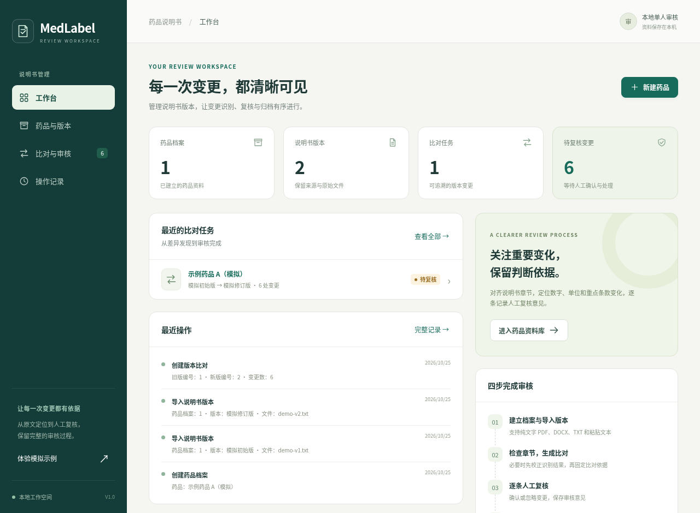

### 3.2 首次体验

首次使用可点击侧栏“体验模拟示例”。系统建立模拟药品的两个版本及一个比对任务，并打开变更审核页面。示例文字用于演示数字、条款及章节增删变化，不是实际药品说明书，不得用于临床。默认示例的单位保持不变，不能将它作为单位变化识别的演示结果。

重复点击该按钮不会反复生成同一套演示数据。此前保存的示例审核状态会保留，重新打开时不一定全部处于待复核状态。

### 3.3 完整工作顺序

建议依次执行：建立药品档案、导入旧版和新版、核对来源与原文、校正章节、创建比对、逐项审核、导出报告、保存原始资料和备份。创建比对后，参与该任务的章节会固定，因此应先完成章节核查，再生成正式比对任务。

## 4 药品档案管理

### 4.1 检索药品

点击“药品与版本”进入药品列表，在搜索框输入药品名称、厂家或批准文号中的文字，列表随输入筛选。点击目标药品进入其档案，查看基本信息和说明书版本。搜索无结果时应核对关键词，或清空搜索条件恢复完整列表。

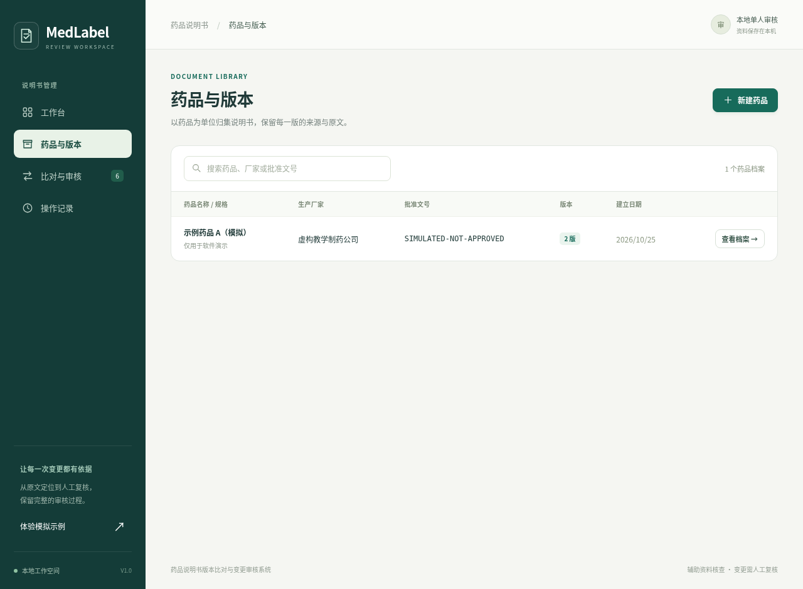

### 4.2 建立档案

点击“新建药品”，在“建立药品档案”对话框中填写信息：

| 界面字段 | 填写要求 |
| --- | --- |
| 药品名称 | 必填，用于列表、比对任务和报告展示 |
| 生产厂家 | 按说明书标示内容填写，可空 |
| 药品规格 | 按待管理资料填写，可空 |
| 批准文号 | 按原始资料填写，可空 |
| 备注 | 可记录资料用途、来源范围或其他说明 |

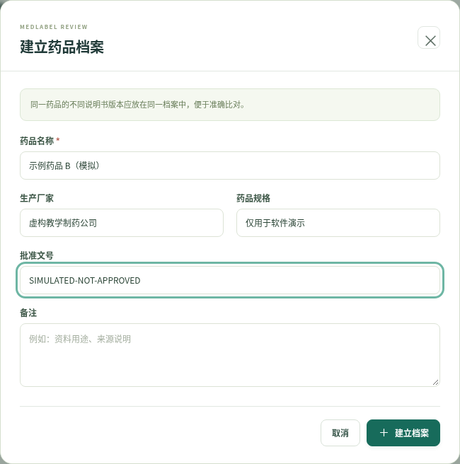

点击“建立档案”完成保存；点击“取消”或关闭按钮放弃当前未提交内容。成功后进入药品详情，可继续导入说明书。名称仅含空格时不能提交。

同一档案内的文件应由使用者确认属于需要相互比对的同一药品资料。软件不会查询监管数据库核验批准文号，也不会自动核实不同厂家或规格是否属于同一注册产品。需要区分管理时应分别建立档案。当前界面提供新增和查询，不提供药品档案的编辑或删除入口。

## 5 导入和查看说明书版本

### 5.1 版本信息

进入药品详情，点击“导入版本”；尚无版本时也可点击“导入第一个版本”。每次导入形成一个独立版本，导入前填写版本名称、版本日期和资料来源。

版本名称用于区分资料，可采用“初始版”“某年修订版”等可理解名称。版本日期应反映该份资料的实际版本信息，不应为满足比对条件随意更改。资料来源可填写发布机构、公告网址、文件编号或提供方，界面要求填写该项，报告会保留其内容。

V1.0 未提供版本名称、日期、来源的编辑或删除入口。发现这些信息录错时，应使用正确信息重新导入一个版本，并核对后续比对任务所选版本；章节校正只调整章节标题和正文，不会修改上述版本资料。

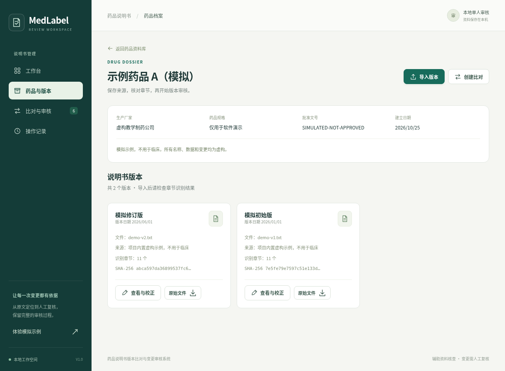

### 5.2 上传文件

在导入窗口选择“上传文件”，点击“选择说明书文件”并选择本地文件，然后点击“导入并识别章节”。文件须满足以下条件：

| 类型或限制 | 本版支持范围 |
| --- | --- |
| TXT | UTF-8 或 GB18030 编码的非空文本 |
| PDF | 不含图片、未加密且可提取文字的 PDF，最多 100 页 |
| DOCX | 可读取的 Word 文档文字，可包含表格、文本框及页眉页脚文字 |
| 文件大小 | 单文件不超过 10 MB |
| 提取正文 | 应用接受的文本不超过 300000 个字符 |

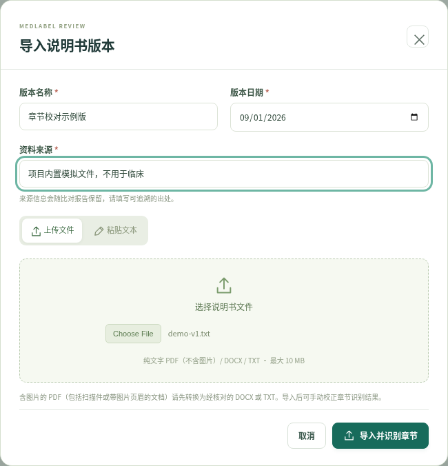

首版不支持 DOC、图片或扫描件 OCR。含图片的 PDF 会被拒绝，包括有可提取页码但正文为扫描图像、含图片页眉或标志的文件。此时应先在外部工具中转换为完整文字，再与原件核对后导入 TXT 或 DOCX。DOCX 中的图片文字不会自动识别；有关键内容位于图片中时，应先转为经核对的文字资料。

含未处理修订、脚注或尾注的 DOCX 需先处理或转成包含完整内容的文本。损坏文件、异常压缩文件或空文件不能导入。程序不会因文件扩展名正确而保证其内容可读取。

导入成功后，系统保存原始资料并打开章节查看窗口。请先核对提取结果，再关闭窗口继续导入下一版。若显示错误提示，修正文件或输入内容后重试；不要仅凭文件选择框中已有文件就认为导入成功。

### 5.3 粘贴文本

在导入窗口选择“粘贴文本”，保留版本名称、日期和来源，将完整正文粘贴到“说明书原文”。应保留“【药品名称】”“【用法用量】”等章节标题及必要换行。确认正文非空后点击“导入并识别章节”。

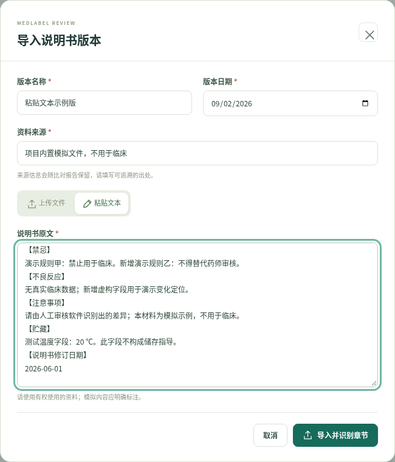

粘贴内容将以文本形式保存为该版本的原始资料。粘贴前应核查复制过程中是否遗漏表格、符号、脚注或分页内容；模拟资料应在正文或来源中明确标注。

### 5.4 查看版本资料

药品详情中的版本卡片显示版本名称、日期、文件、来源、章节数和文件摘要前缀。点击“原始文件”下载保存的文件；点击“查看与校正”打开版本窗口。窗口提供“章节与校正”“原始提取文本”“来源与文件”三个选项。

“原始提取文本”用于核对解析后的全文。其换行和阅读顺序可能与 PDF 版面不同，必须结合原文件检查。“来源与文件”显示资料来源、完整 SHA-256 及导入时间，并提供“下载原始文件”。摘要用于核对文件内容，不能证明来源真实或监管核准状态。

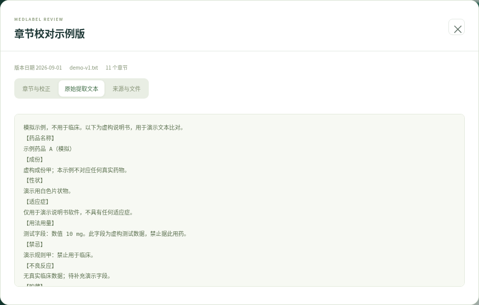

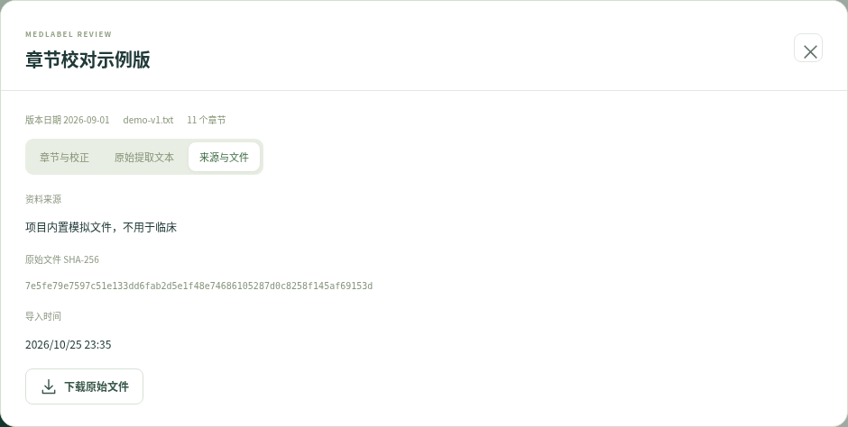

## 6 检查和校正章节

在版本窗口选择“章节与校正”，逐项检查章节标题和正文。系统可以识别常见说明书标题，并保留未被标准标题覆盖的文字及重复标题。自动识别结果可能受排版影响，不能代替原件核对。

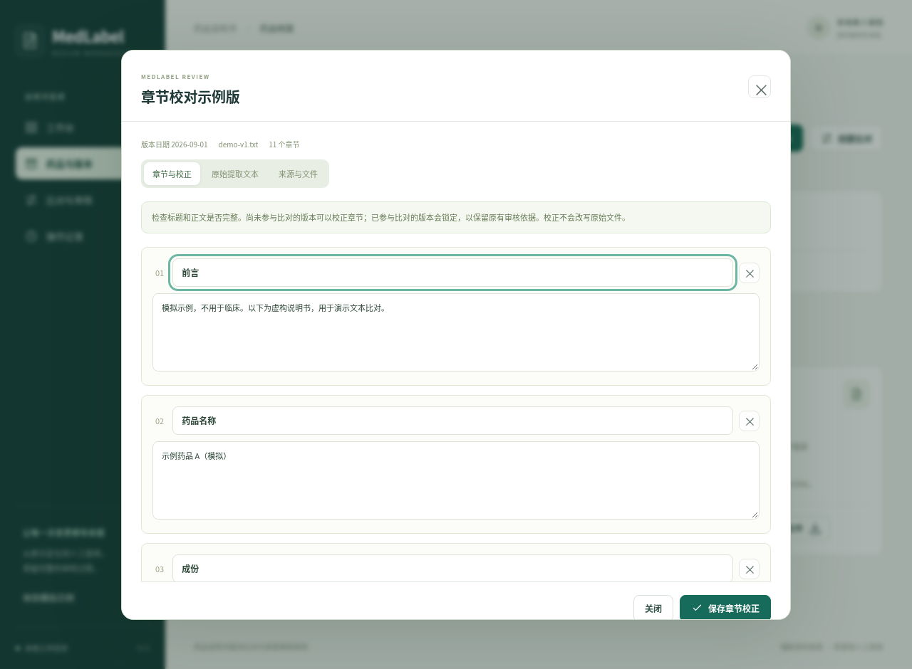

校正时可修改标题及正文，点击“添加章节”增加内容，或使用章节旁的移除按钮调整结构。移除含正文的章节会出现确认提示；至少需要保留一个章节，且界面要求至少有一个章节含正文。确认各项内容后点击“保存章节校正”。保存完成后窗口展示更新后的结构及人工校正提示。

应重点检查数字、小数点、计量单位、否定词、特殊人群条款、表格文字和跨页内容。校正的目的是恢复资料的正确结构和文字，不能通过改写内容掩盖真实版本差异。

校正不会替换原始文件或原始提取文本，系统另行记录章节修改。经过人工校正的章节在比对中显示“手工校正章节”，不再把位置当作原文行号。

版本首次用于比对后，系统拒绝修改其章节，以保持历史审核依据。需要纠正已锁定版本时，应将更正资料作为新版本导入，再创建新的比对任务。仅关闭提示、刷新页面或重新打开窗口不会解除此限制。

## 7 创建和阅读版本比对

### 7.1 创建任务

同一药品至少有两个版本后，在详情页点击“创建比对”。在对话框中选择“旧版说明书”和“新版说明书”，确认无误后点击“生成章节比对”。两个版本必须不同，旧版日期不能晚于新版日期。

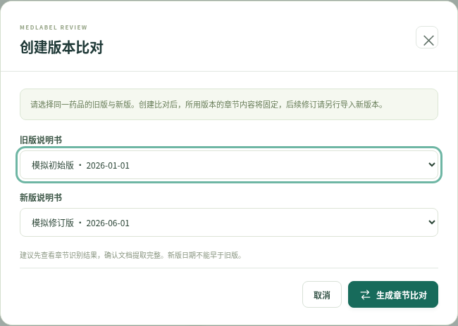

系统完成比对后打开审核页面。任务保存在“比对与审核”中，可通过药品名称或版本文字检索，并按“全部任务”“有待复核变更”“已完成复核”筛选。重复对同一对版本建立比对会形成独立任务，其审核状态分别保存。

### 7.2 阅读差异

页面顶部显示版本名称、日期、变更章节数、内容一致的章节数和审核完成度。每张差异卡片显示章节名称、变化类型、提示、两版文字及位置。左侧为旧版，右侧为新版；红色标识删除，绿色标识新增。

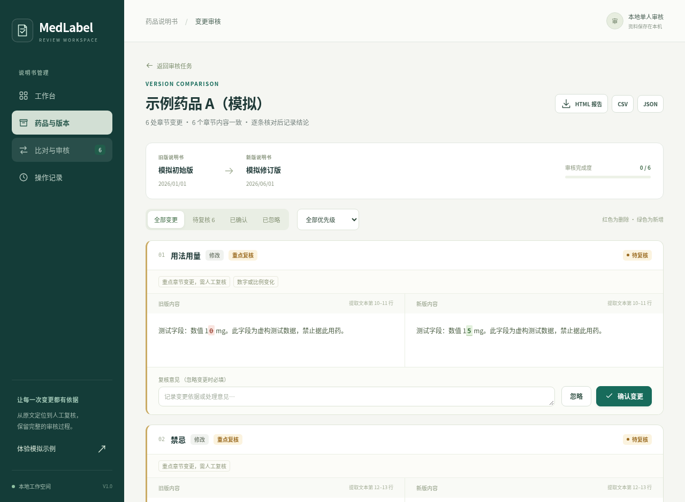

| 差异或提示 | 阅读方法 |
| --- | --- |
| 新增 | 新版出现而旧版无对应内容的章节 |
| 删除 | 旧版存在而新版无对应内容的章节 |
| 修改 | 对齐章节的正文发生变化 |
| 重点复核 | 重点章节或数字、单位等发生规则识别的变化 |
| 提取文本行号 | 对应提取后的文本行，不是 PDF 页面坐标 |
| 手工校正章节 | 章节经过人工修改，需要结合原始文件核查 |

可用“全部变更”“待复核”“已确认”“已忽略”切换状态，也可按“全部优先级”“重点复核”“常规复核”筛选。筛选只改变当前显示范围，不删除任务中的变化。

重复标题按出现次序配对，并提示人工核对。章节顺序调整会提示，但不单独算作正文变化。没有标准标题或超长章节时也会给出相应提示；超长章节可能整体显示增删，须结合完整原文检查。“未发现章节内容差异”不等于证明两份原始资料在所有版面、图片或药学含义上完全一致。

比较时会折叠连续空白，并去掉相邻汉字之间的空白，因此部分排版空白差异不生成变更。数字之间的分隔、标点、单位和否定词仍影响比较结果。若未检出变化，任务会显示已完成、待复核数为 0；这是没有待处理差异的计算结果，不表示已经完成一次独立的人工核查。

## 8 人工审核变更

### 8.1 确认与忽略

每条变化初始为“待复核”。核对原始资料和两版文字后，在“复核意见”中记录依据，点击“确认变更”，状态变为“已确认”。再次调整意见时点击“保存确认意见”。

如果判断某条差异无需纳入本次关注范围，应填写明确原因再点击“忽略”。原因未填或仅为空白时不能保存。“已确认”表示使用者完成了该项资料核对，不表示药品安全性或监管合规已获批准。

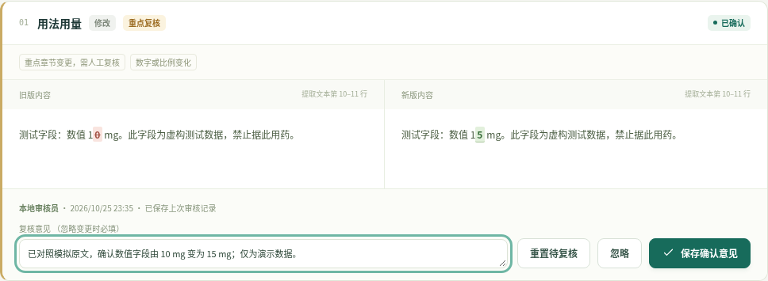

### 8.2 重新核查与保存冲突

已确认或已忽略的变化提供“重置待复核”按钮。需要再次核查时点击该按钮，任务的待复核数量和完成度相应更新。系统保存每次状态变化及意见，不应把当前卡片上的最后一次记录当作全部历史。

如果在多个浏览器标签页打开同一任务，其他页面保存后，旧页面再次提交可能出现冲突提示。界面会自动重新读取最新记录，并保留当前页面内尚未提交的意见供核对；这次冲突提交没有保存成功。请比较最新状态与草稿意见，再决定是否重新保存。如果还要手动刷新整个浏览器页面，应先另外保存草稿，以免页面内未提交内容丢失。系统通过记录修订号拒绝过期提交，避免旧内容覆盖新结论。

审核进度达到全部处理完成，表示每条检出的变化均已确认或忽略；忽略原因和结论质量仍由使用者核查。输入意见后必须点击相应按钮并确认成功提示，单纯离开输入框不会保存。

## 9 导出与归档

在比对审核页点击“HTML 报告”“CSV”或“JSON”下载当前结果。导出文件包含药品名称、版本名称和日期、资料来源、原始文件摘要、章节变化及审核信息，反映导出时点的状态。

HTML 报告可独立打开，按章节展示新旧内容、复核提示和意见。使用浏览器“打印”功能可选择另存为 PDF。系统提供的是 HTML 下载，PDF 由浏览器打印生成。

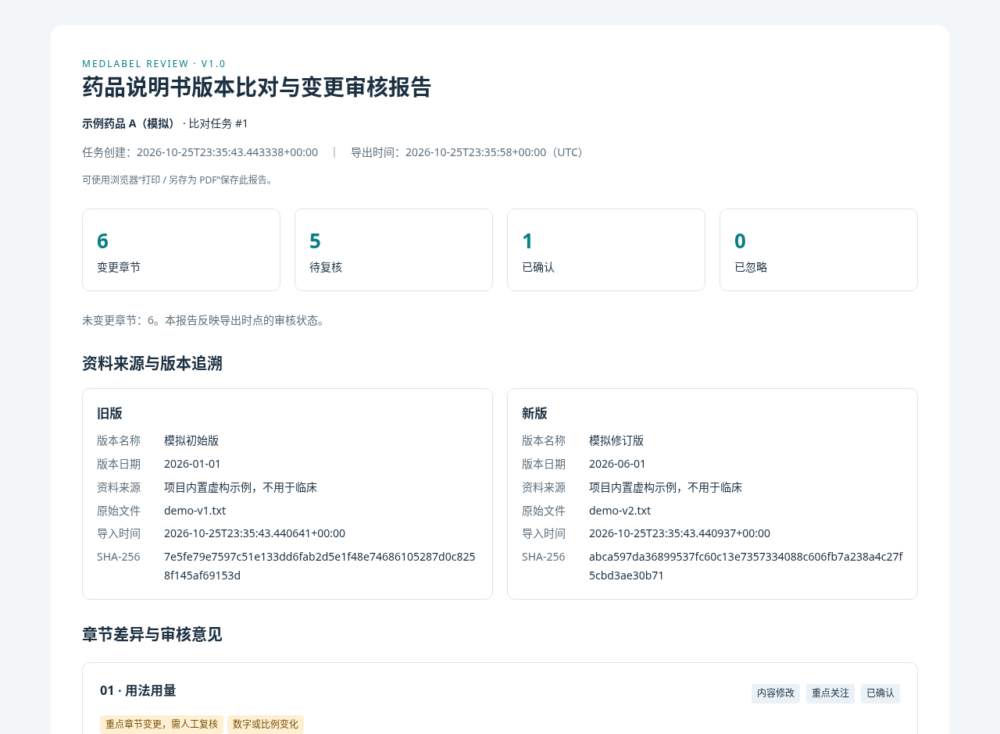

CSV 适合在电子表格中整理，JSON 适合程序读取。CSV 对可能被表格程序解释为公式的内容进行处理；打开后不应因展示形式不同擅自删除原文。仍存在待复核项时也可以导出，报告保留待复核状态，不应据此宣称任务已经审核完成。

归档时建议同时保存报告、两份原始文件和来源说明。导出报告不能替代完整应用数据备份，也不能独立恢复药品档案、版本附件及所有操作历史。

## 10 操作记录与数据保存

### 10.1 查看操作记录

点击“操作记录”查看创建档案、版本导入、章节校正、比对生成和审核更新等动作。列表显示时间、操作、操作对象、记录内容和记录人。可输入关键词筛选，也可点击“刷新记录”重新读取。

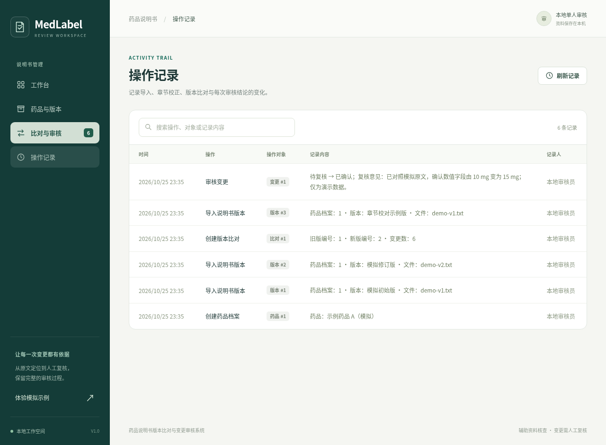

当前列表最多读取最近 500 条记录，页面无匹配项不必然说明历史数据库中没有该动作。审核员默认为“本地审核员”；配置其他显示名称后，新操作使用新名称，既有记录仍保留当时信息。日志存于本地数据库，不是外部认证的不可篡改审计链。

### 10.2 数据目录、备份与恢复

使用 `run.py` 启动时，默认数据目录为项目目录下的 `data`。其中 `medlabel.sqlite3` 保存业务记录，`uploads` 保存原始资料。可用 `python run.py --data-dir 指定目录` 选择其他位置。直接使用 Uvicorn 启动的配置方法以项目运行说明为准。

备份前保存页面编辑并停止服务，再完整复制数据目录。数据库和附件必须一起备份，不能只复制其中一个。恢复时保持停服状态，将完整目录恢复到目标位置，然后以该目录启动并核对档案、版本和原文件下载。

源代码目录和业务数据目录的用途不同。重新下载项目源码不会自动恢复历史业务资料；修改数据目录也不会自动迁移旧资料。请在替换项目或调整路径前确认已完成备份。

## 11 常见问题处理

| 现象 | 原因或检查方向 | 处理方法 |
| --- | --- | --- |
| 浏览器无法打开页面 | 服务未启动、端口错误或进程已停止 | 检查终端启动信息，使用对应本机地址和端口 |
| 导入按钮无法提交 | 必填字段、正文或文件不完整 | 检查版本名称、日期、来源和导入内容 |
| PDF 被拒绝 | 含图片、加密、损坏或超过页数限制 | 转成经核查的完整文字文件后重试 |
| DOCX 被拒绝 | 文件损坏、异常压缩、修订或脚尾注未处理 | 使用文字处理软件整理完整内容后重新保存 |
| 提取结果不完整或顺序异常 | 文档版式或复制过程影响 | 对照原件整理文本，在比对前校正章节 |
| 章节保存失败 | 标题为空、内容超限或版本已被引用 | 修正输入；已引用版本以新版本方式处理 |
| 创建比对失败 | 版本相同、所属药品不同或日期倒置 | 核对资料归属和真实版本日期后重新选择 |
| 忽略操作失败 | 未填写忽略原因 | 补充复核依据后保存 |
| 审核保存提示冲突 | 其他页面已更新同一条记录 | 读取最新记录后重新核查并提交 |
| 找不到旧资料 | 数据目录变化或只恢复了部分文件 | 检查启动路径，使用完整备份恢复 |

## 12 示例操作与完成检查

初次演示可使用项目 `examples` 目录中的 `demo-v1.txt` 和 `demo-v2.docx`。建立注明“模拟”的药品档案，分别导入两份资料，并填写与示例相符的新旧日期及“项目内置模拟资料”来源。逐项查看章节、原文和文件摘要，确认输入内容完整，再生成比对。

使用未修改的内置示例时，两版各识别出 11 个章节。比对结果应为 6 个一致章节、6 条变化，其中 4 条修改、1 条新增、1 条删除；5 条为重点复核、1 条为常规复核。重点复核来自章节与数字规则，包括修订日期的数字变化，不是医学风险判断。新建任务的 6 条变化均为待复核；确认一条并忽略另一条后，剩余 4 条待复核。重复打开此前已审核的演示任务，状态可能不同，应与新建任务区分。

在审核页面选择一项变化，填写“已对照模拟原文，确认演示变更”并确认；选择另一项变化，填写清楚的演示忽略原因并忽略。切换状态筛选，核对条目和审核完成度。导出 HTML 报告，在浏览器查看两版来源与意见，再进入“操作记录”确认操作已留存。

正式结束一次资料核对前，应确认版本选择正确、章节结构已核验、原文位置可回查、待复核项已按实际情况处理、忽略项有原因、报告与原始资料已归档。需要继续处理的事项应保留待复核状态，不能通过批量忽略或改写原文掩盖未完成工作。
