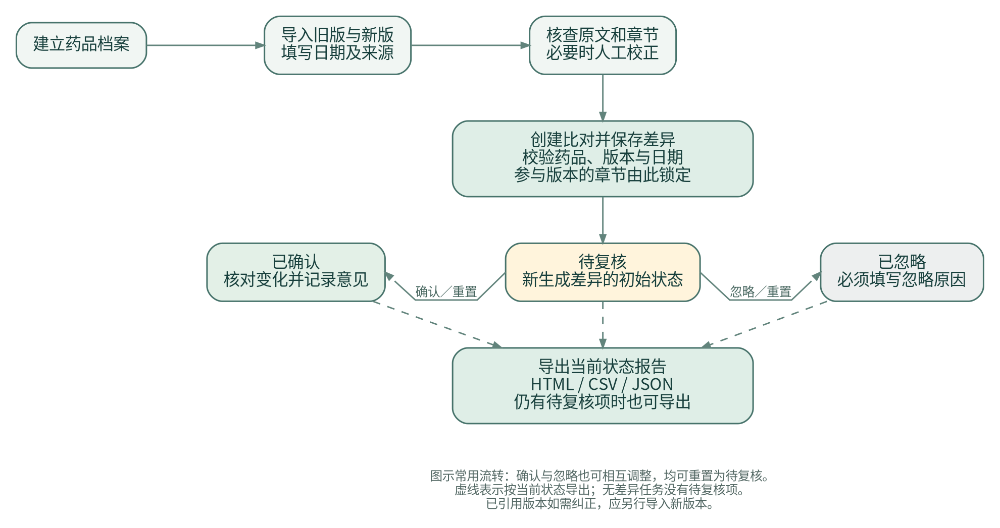
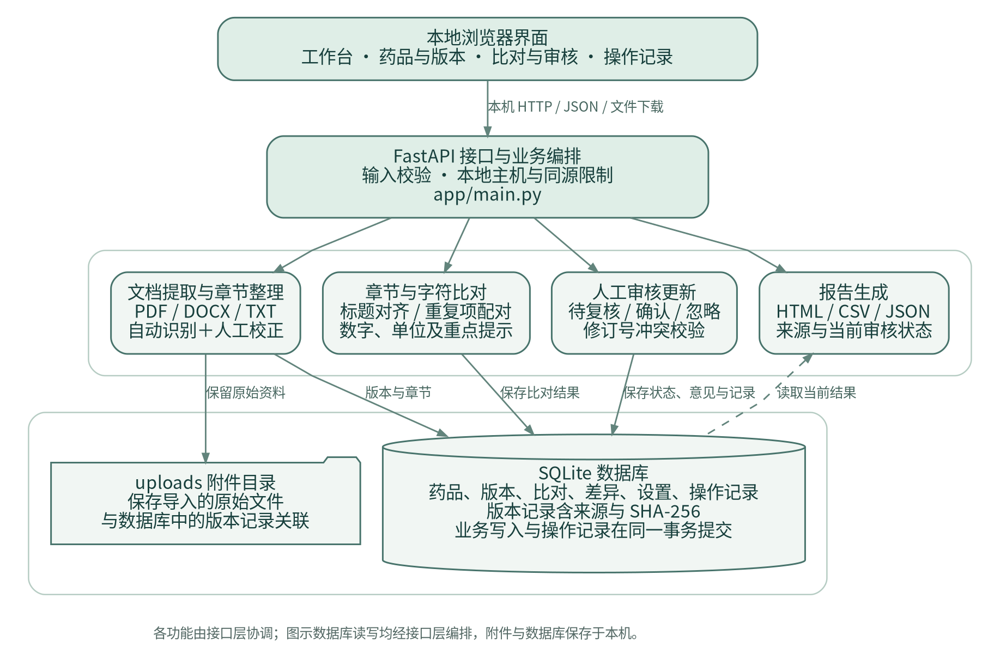

# 药品说明书版本比对与变更审核系统 V1.0

## 软件设计说明书

| 文档项目 | 内容 |
| --- | --- |
| 软件全称 | 药品说明书版本比对与变更审核系统 |
| 软件版本 | V1.0；程序内部版本标识为 1.0.0 |
| 英文项目名 | MedLabel Review |
| 对应程序版本 | 98e406f93f8777fc416014cee05d1737966fab4e |
| 著作权人 | 待申请人填写 |
| 文档用途 | 说明软件的应用背景、处理问题、设计依据、内部结构和实际实现 |

本文描述上述代码版本已经实现的功能。示例药品、说明书文字、数值及审核意见均为虚构的软件演示资料。本文所称“审核”是使用者对文本差异进行确认、忽略及记录的操作，不是药品审评审批。

## 1. 应用背景与待解决问题

药学资料整理时，同一药品可能保留多个日期的说明书文件。使用者需要确定本次比较的是哪两份资料，找出章节及文字变化，再将核对意见与具体变化对应保存。文件格式、标题写法、章节顺序和排版换行可能不同；直接从文档开头逐行比较，容易把结构差异与内容差异混在一起。

以本项目的模拟资料为例，旧、新版都含“用法用量”，其中数值从 10 mg 改为 15 mg；新版另有新增“注意事项”和删除“包装”的变化。使用者除了看见文字改变，还需要知道变更属于哪个章节、原文件是什么、是否已处理、此前处理意见能否回查。这里只用虚构字段说明资料处理需求，不据此评价真实药物。

本软件针对以下四个具体问题设计：

1. 版本依据分散。仅凭文件名难以同时表达药品归属、版本日期、资料来源和导入时保存的文件内容；报告与文件分开后，也不便核查其对应关系。
2. 文本变化定位不清。标题别名、章节重排和版式空白可能产生阅读干扰，而新增、删除、数字或单位变化需要保留明确的前后文。
3. 复核结果与差异脱节。把意见另记在表格或笔记中时，需要额外维护“意见对应哪次比对、哪个章节”的关系；重新比对后也可能混用旧意见。
4. 后续修改影响已有依据。若比对建立后仍能直接改变输入章节，或者旧窗口覆盖新审核意见，已导出的结果就难以解释其形成过程。

本项目的目标是把“归集版本—定位差异—人工处理—保存依据—导出记录”放在同一条可查阅的业务流程中。本文不主张现有其他软件均无法解决这些问题，也不以未经验证的效率提升比例、识别准确率或临床效果作为设计依据。

## 2. 使用对象、需求与设计范围

### 2.1 使用对象及运行假设

使用对象为开展说明书资料整理、文本核对、教学演示的人员。V1.0 按单机、单个可信操作者设计：浏览器访问本机服务，业务文件保存在本地目录。操作者负责合法取得输入资料，核查提取结果，填写版本信息，并决定如何处理差异。

同一操作者可能同时打开多个浏览器窗口，因此单人使用仍有旧窗口提交过期意见的情况。系统采用修订号检查处理这一问题，但未据此实现多人账户、权限角色或电子签名。

### 2.2 需求与设计决策对应

| 需求编号与目标 | 采用的设计 | 可观察结果与实现位置 |
| --- | --- | --- |
| R1：固定两版资料的归属与来源 | 档案下保存独立版本，保留原文件、提取原文、日期、来源和 SHA-256 | 版本详情可查看原文并下载原件；app/main.py 的 add_version、version_data |
| R2：按章节定位变化，减少结构扰动 | 标题规范化及明确别名映射；同名章节按出现次序配对 | 新增、删除、修改分别列出，重排及重复标题另作提示；parse_sections、compare_sections |
| R3：让使用者优先查看特定变化 | 固定重点章节表，比较数字和计量词序列 | 每项差异显示关注标记与重点/常规级别；app/comparison.py |
| R4：保存差异对应的人工处理意见 | 每个比对拥有独立差异记录；每项保存状态、意见、操作者标签、时间和修订号 | 可确认、忽略和恢复待复核；review_change 及 changes 表 |
| R5：避免历史依据被后续操作覆盖 | 已被比对引用的章节禁止修改；审核更新检查 revision；业务与日志同事务 | 无效修改被拒绝，冲突返回 409；update_sections、Database.connect |
| R6：让结果离开程序后仍可核查 | 导出时同时组织来源、差异、审核状态及导出时间 | HTML、CSV、JSON 均包含版本来源信息；app/reports.py |

设计选择强调输入、输出和人工操作能够相互对应。SHA-256 用于核对文件内容；关注标记用于安排复核顺序；审核记录用于回查处理过程。三者均不替代对资料真实性、医学正确性或权利归属的专业判断。

### 2.3 功能边界

本版支持药品档案建立与查询、说明书版本导入、自动章节识别及人工校正、两版章节和字符差异、逐项审核、报告导出、操作记录查询。档案和版本未提供编辑元信息或删除接口；改变已有资料时，应根据实际情况建立新档案或导入新版本。

导入格式为 TXT、纯文字且不含图片的 PDF、DOCX，以及粘贴文本。系统不提供 OCR、文档翻译、自动医学语义判断、药品监管数据库联网核验、处方生成、多人审批或账户认证。V1.0 的规则比对不调用生成式模型；这描述软件运行方式，不表示其开发过程未使用辅助工具。

## 3. 业务流程及输入输出

完整业务以药品档案为起点，以可回查的差异及审核报告为输出。使用者先创建档案，再在同一档案下导入旧、新两份版本。每份版本导入成功后立即保存原件、原文和自动识别章节；使用者可以先核对章节，必要时人工调整标题和正文。创建比对前的核对属于操作建议，程序不把“已人工核对”设为单独的强制审批状态。

创建比对时，服务端检查两个版本编号不同、属于同一药品档案、旧版日期不晚于新版日期。日期相同且编号不同可以比较。通过校验后，程序生成并保存差异记录；两份版本的章节随后因被引用而不可再修改。需更正时导入新的版本，再创建新的比对任务。

| 处理阶段 | 输入 | 处理与输出 |
| --- | --- | --- |
| 建立档案 | 名称及可选厂家、规格、批准文号、备注 | 保存药品记录和创建日志 |
| 导入版本 | 档案编号、版本名称、日期、来源、文件或文本 | 保存附件、SHA-256、提取原文、章节和导入日志 |
| 核查章节 | 版本详情及原始资料 | 使用者确认或人工校正；校正保留原件和原文，清空不可验证的章节行号 |
| 建立比对 | 同一档案下两份版本编号 | 保存任务、变化章节、未变化章节数及提示；变更初始为待复核 |
| 人工复核 | 差异、目标状态、意见、当前修订号 | 保存审核字段及对应操作记录；返回新的修订号 |
| 导出报告 | 比对编号与导出格式 | 生成反映导出时点状态的 HTML、CSV 或 JSON |

审核过程中可以随时导出，报告如实显示尚待复核的项目。全部差异处理完成后也可再次导出。后续操作不会修改已经下载的报告，重新获取当前结果需要重新导出。对同一对版本再次创建比对会形成独立任务和独立审核记录，不自动沿用旧任务的处理意见。

## 4. 总体架构及技术选择

### 4.1 架构分层

系统由浏览器界面、HTTP 业务接口、文档与比对处理模块、本地持久化组成。浏览器通过同一服务加载静态页面并调用接口；服务端先校验输入，再执行资料解析、比对、审核保存或导出。SQLite 存储结构化业务记录，uploads 保存原始文件，两者通过版本记录中的内部文件名建立联系。

采用本地浏览器界面，便于在同一页面查看版本、原文、差异和审核意见；采用 Python 服务集中处理格式解析及规则，使浏览器不承担文件解析职责；采用 SQLite，减少单机演示对独立数据库服务的安装要求；采用原生 JavaScript 和静态样式，不要求 Node.js 构建流程。以上是本版部署范围内的取舍，不作为大规模协作或高并发系统的性能承诺。

### 4.2 模块职责

| 模块 | 实际源文件 | 主要职责及边界 |
| --- | --- | --- |
| 启动 | run.py | 读取监听地址、端口、数据目录并启动 Uvicorn |
| 业务接口 | app/main.py | 输入模型、档案和版本管理、配对约束、审核状态、事务调用 |
| 持久化 | app/database.py | 建表、连接、外键检查、写事务、操作记录 |
| 文档处理 | app/documents.py | 格式提取、标题识别与规范化、章节切分、人工校正验证 |
| 比对处理 | app/comparison.py | 标题对齐、变化分类、字符差异、关注标记 |
| 报告 | app/reports.py | 组织来源和当前审核状态，输出三种格式 |
| 界面 | app/static/index.html、app.js、styles.css | 路由、表单、原文查看、差异显示、审核和下载 |
| 演示 | app/demo.py、examples/ | 提供明确标注的虚构资料，便于重复验证流程 |

### 4.3 开发和运行支撑

程序以 Python 3.11 及以上版本作为运行要求，使用 FastAPI、Uvicorn、pypdf、python-docx 和 Python 标准库中的 SQLite、difflib 等组件。依赖安装完成后，本地资料处理不依赖外部网络、大模型密钥或第三方数据库服务。

归档验证覆盖 Linux 环境中的 Python 3.11、3.12 自动化测试及 Chromium 浏览器操作。项目提供 Windows PowerShell、macOS/Linux 启动方式，但不把启动脚本的存在表述为这些平台均已通过验收。具体依赖和验证版本分别记录在 requirements.txt、requirements-lock.txt 及测试验收记录中。

## 5. 数据组织、关联关系与不变条件

数据库文件为 medlabel.sqlite3，共六张表。drugs 对 versions 为一对多；每个 comparisons 引用一个药品以及旧、新两个版本；comparisons 对 changes 为一对多。audit 通过对象类型和编号逻辑关联操作对象；settings 保存演示初始化标记。完整字段见附录 A。

### 5.1 原始依据与处理结果分别保存

每个版本保留三种内容：上传文件的原始字节、格式提取后的原文、用于比较的章节结构。原件用于回查输入，原文用于检查格式提取，章节用于规范组织比较。人工校正只替换章节结构，不回写附件或提取原文，也不重新计算其 SHA-256。

章节项包括 key、title、text、start_line、end_line。title 保存用于展示的标题，key 标识规范化后的标题与出现次数，text 保存该章正文。自动识别的行号指向提取文本，包含标题所在行，不是 PDF 页码或屏幕坐标。人工校正后的行号设为空，避免将修改后的正文假装定位到原始行号。

比对建立时，差异正文、类型、位置、标记和字符片段写入 changes.payload；审核字段单独保存。比对详情读取已保存的 payload，不因用户再次打开页面而重新计算差异。既有比对引用的章节不可修改，使报告中的版本、来源和变化记录保持相互对应。

### 5.2 数据约束

| 不变条件 | 实现措施 | 对业务的作用 |
| --- | --- | --- |
| 版本必须归属于已有药品 | 导入先查询档案，数据库使用外键 | 防止形成无所属档案的版本 |
| 比对必须引用同档案的不同版本 | add_comparison 校验编号、药品和日期；数据库 CHECK 检查编号不同 | 防止把不同药品或反向日期当成同一次修订 |
| 比对依据固定 | update_sections 检查是否被任意比对引用 | 更正输入时通过新版本保留旧依据 |
| 审核状态只能取定义值 | 输入 Literal 与数据库 CHECK | 避免未知状态进入统计和报告 |
| 旧窗口不能覆盖较新审核 | 比较 revision，再在写事务中更新并递增 | 显式提示冲突，由使用者重新读取后处理 |
| 状态变更与日志同时保存 | 业务写入及 audit 使用同一数据库连接、事务 | 避免正常异常路径下出现有修改无记录 |

统计字段 total_changes、pending_changes 和任务状态由当前差异记录汇总，不另行保存可失配的计数。未变化章节数量在生成比对时保存，因为它属于该次比较的计算结果。日期使用 YYYY-MM-DD 文本，操作时间使用带 UTC 时区的 ISO 时间文本；对象结构以 JSON 字符串保存。

## 6. 文件导入、章节解析与校正设计

### 6.1 导入处理顺序

add_version 首先检查档案及版本元信息，再检查文件字节和扩展名，调用 extract_text 提取原文，检查应用正文长度，调用 parse_sections 生成章节。解析成功后才写入附件和版本记录，同时写入导入日志。粘贴文本转为 UTF-8 字节，以 pasted-text.txt 名称走同一保存流程。

文件名去掉路径部分后用于展示；内部文件名使用 UUID 与扩展名，避免由上传名称决定保存位置或覆盖同名附件。SHA-256 对原始字节计算，因此不同编码或文件容器的字节不同，即使可读正文相同，其摘要也可能不同。系统不使用摘要证明发布来源或自动判定两个文件语义相同。

数据库写入失败时回滚事务，并在常规异常路径清理本次新建附件。文件系统与数据库不是同一种事务资源，突然断电或强制终止仍可能需要人工核对；本版未实现跨文件系统的事务恢复协议。

### 6.2 格式提取策略

| 输入格式 | 提取方法 | 采用此策略的理由与限制 |
| --- | --- | --- |
| TXT | 依次尝试 utf-8-sig、GB18030，统一换行并清理 BOM | 支持常见文本编码；空文本、空字符及无法识别编码给出错误 |
| PDF | 校验标识、加密、页数和图片资源，再按页提取文字 | 防止“扫描正文＋可提取页码”造成正文遗漏；检测到图片即拒绝，含徽标的文件也可能被拒绝 |
| DOCX | 检查 ZIP 包后遍历页眉、正文、页脚中的段落与文字节点 | 保留表格和文本框文字；不执行图片识字，也不保证还原复杂版式 |
| 粘贴文本 | 按 UTF-8 保存为文本原件 | 与文件导入统一追溯和比对，不另设一套差异算法 |

PDF 图片检查覆盖页面资源、嵌套 Form、内联图像、图案和批注外观中的图片；过深或过多的图形结构也会拒绝。DOCX 对未接受的插入/删除修订以及脚注、尾注引用予以拒绝，提示先转换成完整文字；嵌套文本框段落单独读取，避免重复拼入外层段落。导入后的人工核查仍然必要，格式被接受不等于文字完整性已经得到认证。

### 6.3 标题识别和章节键生成

parse_sections 按提取文本行顺序处理。标题识别接受【】、[]、［］包围的标题，也接受明确别名表中的无括号标题或标题后接冒号的形式。类似 [1] 的纯数字参考编号不作为章节标题；未知的普通正文短句也不提升为标题，减少误切分。

canonical_title 对标题执行 NFKC 规范化，清理前缀序号与空白，再使用显式别名表。例如“成分”和“成份”归为同一键，“适应证”和“适应症”归为同一键。没有相应别名的标题保留自己的规范化形式，不进行模糊医学概念合并。

第一处标题之前的文字保留为“前言”；全文没有识别到标题时，保留为“全文”章节。未知括号标题和空正文标题也保留。重复标题按出现次序生成“成份”“成份#2”等键；标题原有的半角井号先转换，防止与次数后缀碰撞。原文件只有一个章节时，版本记录附带提醒使用者核查结构的提示。

### 6.4 人工校正及输入上限

使用者可以在尚未参与比对的版本中添加、删除或修改章节。服务端重新校验并生成键，所有校正章节的行号置空，记录校正前后结构。任何一次比对引用该版本后，继续保存校正返回 409，应重新导入版本。当前界面仍可打开章节查看窗口，是否允许保存由服务端最终判断。

| 检查位置 | 实际限制 |
| --- | --- |
| 文件字节 | 不超过 10 MiB |
| 应用导入正文 | 不超过 300,000 字符 |
| PDF 页数 | 不超过 100 页 |
| DOCX 包 | 不超过 2,500 个条目，解压体积不超过 40 MiB |
| DOCX 压缩比 | 单条目超过 1 MiB 且压缩比大于 200 时拒绝 |
| 自动章节 | 最多 500 个 |
| 人工校正 HTTP 接口 | 1 至 200 个章节；标题和正文合计不超过 300,000 字符 |
| 人工章节标题 | 最终经 normalize_sections 检查为 1 至 120 字符 |
| 资料来源 | 界面要求填写且最多 1,000 字符；服务端接受空值且最多 2,000 字符 |
| 审核意见 | 不超过 3,000 字符 |

底层文档处理函数另设 1,000,000 字符保护上限，人工校正底层函数最多接受 500 章；经本应用入口时适用表中更严格限制。自动导入形成 201 至 500 章时，可以保存导入结果，但原样提交人工校正将超过接口上限，需要先整理章节或重新拆分资料。前端和 SectionInput 的标题长度上限为 200，但 normalize_sections 最终只接受 120，故本版有效标题上限按 120 说明。这里如实区分各层约束，未把底层上限写成界面能力。

## 7. 章节对齐、差异计算与关注规则

### 7.1 对齐和变化分类

compare_sections 从章节标题重新计算规范化键，不信任调用者传入的可变 key。两版以“规范化标题＋同名出现次数”建立索引，结果按新版章节顺序输出，再追加旧版独有章节。它不依赖两版相同行号或相同章节序号，因此章节重排不会直接造成整篇错位。

| 两侧对应关系 | 判定结果 |
| --- | --- |
| 仅新版存在该键 | added：新增章节 |
| 仅旧版存在该键 | removed：删除章节 |
| 两侧都有且规范化正文不同 | modified：内容修改 |
| 两侧都有且规范化正文相同 | 计入 unchanged_sections，不生成待复核差异 |

比较前，_comparison_text 将连续空白折叠为一个空格，并删除中文字符之间的空格，减少换行排版干扰。该规范化不移除否定词、标点、小数点或数字之间的分隔空格；“1 0 mg”不会被合并成“10 mg”。完整原文仍保存在版本和差异中，规范化只用于是否生成正文变化的判定。

如果共有章节的先后顺序不同，输出重排提示；存在重复标题，输出按出现次序配对的提示；任一版本仅作为“全文”比较时，提示可在创建任务前整理章节。重复章节的次序配对不保证语义上一一对应，需使用者核对。标题改名且不在别名表内时，会呈现旧章删除和新章新增；已识别别名之间仅标题写法变化、正文相同时，不单独产生标题变化记录。

### 7.2 字符差异和原文重建

对已判定发生变化的章节，_inline_segments 使用 SequenceMatcher 在原始章节正文上计算字符差异，产生 equal、delete、insert 三种片段。替换由一段删除和一段插入表达。把非 insert 片段拼接应得到旧文，把非 delete 片段拼接应得到新文；这一性质用于前端显示校验及自动测试。

对两侧正文均非空的变化章节，长度合计超过 30,000 字符时，不继续细粒度匹配，改为整段旧文删除与整段新文插入，同时提示人工对照。纯新增或纯删除直接展示相应一侧全文，不追加该长章节提示。这个处理限制长输入的比较开销，未承诺所有输入都能即时完成。空新增、删除章节仍按章节存在性列入变化，不因正文为空而消失。

### 7.3 关注标记的确定

关注标记由三个彼此独立的条件产生：第一，规范化标题属于固定重点章节表，例如用法用量、禁忌、不良反应、注意事项、特殊人群用药、药物相互作用等；第二，正则提取的数字或比例序列在两侧不同；第三，正则提取的单位及剂型计量词序列在两侧不同。

数字提取允许中文紧邻数字，可包含正负号、小数或逗号分隔形式及百分号。单位表包括 mg、g、mL、IU、℃ 和毫克、毫升、片、粒等明确列出的词。程序比较的是按出现顺序得到的字符串列表，不执行数值换算、剂量等价判断或语义理解；日期数字、数字格式或单位字母大小写变化也可能触发提示。未被表和正则覆盖的表述可能没有专门标记，但已识别的正文变化仍会显示。

重点章节或数字、单位序列变化使 priority 为 high，其他为 normal。长章节整段展示提示本身不必然使优先级升高。界面中的“重点复核”和报告中的“重点关注”对应同一个 high 值，表示阅读顺序，不表示医学风险高低。未变化的重点章节不会因为名称在表内而被额外列为变化。

## 8. 审核状态和一致性设计

### 8.1 单项状态与任务汇总

每项差异创建时为 pending（待复核），revision 为 0。使用者可以将其保存为 confirmed（已确认）或 ignored（已忽略），也可以把已处理项目恢复为 pending。所有合法状态之间均可重新保存，不存在最终签署后不可撤销的审批阶段。

| 操作 | 保存条件 | 保存后的效果 |
| --- | --- | --- |
| 确认变更 | 提交当前 revision；意见可为空 | 状态为 confirmed，保存意见及时间 |
| 忽略变更 | 提交当前 revision，必须填写非空原因 | 状态为 ignored，保存忽略原因及时间 |
| 恢复待复核 | 提交当前 revision | 状态为 pending，保留本次操作记录；任务可能重新出现待复核项 |
| 修改已确认意见 | 提交当前 revision | 保存新意见并递增 revision，旧意见可由日志回查 |

每次成功保存均写入操作者显示名、操作时间、意见，并使 revision 加一。相同状态的再次保存也属于一次更新。任务有待复核项目时为 pending；待复核数为零时为 completed。没有检出变化的任务也为 completed。完成度为已处理项数与变化项总数的关系，不是软件对说明书正确性的评分。

### 8.2 修订冲突与原子更新

浏览器读取差异时获得 revision，提交审核时连同目标状态和意见发送。服务端在 BEGIN IMMEDIATE 写事务中读取最新记录；若修订号不同，返回 409，不覆盖已有意见。相同时，更新状态并递增修订号，再把更新前后的状态、意见和新修订号写入 audit，最后一起提交。异常时一起回滚。

例如同一差异 revision 为 0，窗口甲确认后变为 1。窗口乙仍用 0 提交忽略，服务端拒绝。前端收到 409 后重新读取任务状态并保留当前意见草稿，乙需结合最新记录判断是否继续提交，不能把“最后一次请求到达”作为覆盖原则。连接启用外键和 WAL 模式，SQLite 锁等待超时为 15 秒。该机制服务于本地数据一致性，不提供账户身份验证。

## 9. 界面组织与报告输出

### 9.1 界面组织

界面通过哈希路由组织工作台、药品与版本、比对与审核、操作记录四个工作区。工作台汇总档案、版本、比对和待复核数量；档案详情集中显示该药品的版本；审核页左右并列旧、新正文，并附章节位置、变化类型、关注标记及处理控件。

药品、比对和日志列表在当前已加载记录上提供关键字筛选。审核页同时按单项状态和优先级筛选；筛选只影响当前显示，不改变保存的差异。操作记录接口返回最近 500 条，工作台显示最近 8 条，未实现完整日志分页检索。

所有用户文本插入 HTML 前进行转义。行内片段只有能准确重建该侧正文时才用于着色，否则显示原文。异步路由使用请求代次防止旧响应覆盖新页面；弹窗打开时同步设置初始焦点，避免延迟焦点打断快速填写。表单提供必填、长度、忙碌状态和错误提示。

### 9.2 报告组织

导出读取当前任务、两份版本和所有差异审核状态，并记录导出时间。三种格式均包含版本名称、日期、资料来源、文件名和 SHA-256，以及差异的旧新正文、位置、类型、关注标记、状态、意见、操作者标签、复核时间和修订号。HTML 和 JSON 另保留版本导入时间；CSV 未设置导入时间列。使用者可依据报告中的任务编号和章节信息核对对应记录与原文件，HTML 和 CSV 不提供独立差异编号或返回程序的跳转链接。

| 格式 | 主要用途 | 实现方式 |
| --- | --- | --- |
| HTML | 独立阅读、查看逐字差异和打印 | 页面内置样式及来源信息；可用浏览器打印为 PDF |
| CSV | 在表格软件中整理和筛选 | UTF-8 BOM 编码；以差异为行，重复附带版本来源字段 |
| JSON | 保存完整结构或由其他程序读取 | 保留任务、版本、变化、审核字段，追加导出时间 |

HTML 逐字差异对用户文本转义；报告设置限制性内容安全策略。CSV 对以公式符号开头或经空白隐藏公式前缀的单元格添加文本前缀，减少表格程序解释为公式的风险。下载文件名采用安全 ASCII 字符。系统不直接生成 PDF 文件，不为报告赋予电子签名或监管结论效力。

## 10. 可重复的模拟业务示例

### 10.1 输入及前置条件

使用仓库中的 examples/demo-v1.txt 和 examples/demo-v2.txt，或首次载入内置演示数据；两者为同一组虚构文字。下面按两份 TXT 的未经人工校正的章节结果说明，其他文件格式可能因提取换行不同导致行号不同。

建立“示例药品 A（模拟）”档案，将旧版名称填为“模拟初始版”、日期 2026-01-01，新版名称填为“模拟修订版”、日期 2026-06-01，来源注明项目内置虚构示例。分别导入后，两版均为 11 个章节，包含前言。核对原文完整后，选择两版创建比对。

### 10.2 预期差异与规则解释

| 章节 | 输入中的变化 | 结果与依据 |
| --- | --- | --- |
| 用法用量 | 虚构测试数值 10 mg 改为 15 mg | modified、重点；命中重点章节及数字变化，mg 未变化，不产生单位变化标记 |
| 禁忌 | 新增“不得替代药师审核”的模拟规则 | modified、重点；命中重点章节 |
| 不良反应 | 将待补充演示字段改为新增虚构字段 | modified、重点；命中重点章节 |
| 注意事项 | 新版新增人工核对提示 | added、重点；旧版显示无对应章节 |
| 说明书修订日期 | 2026-01-01 改为 2026-06-01 | modified、重点；数字序列变化，不能理解为日期变更具有医学风险 |
| 包装 | 新版删除模拟包装 A | removed、常规；新版显示无对应章节 |

结果共有 6 项变化，其中 4 项修改、1 项新增、1 项删除；另有 6 个章节内容一致。两版各有 11 章，而其章节键的并集为 12，因此“6 项变化＋6 项一致”与输入章节数并不矛盾。结果含 5 项重点和 1 项常规，未产生重排、重复标题或全文比较提示。TXT 样例的用法用量定位为两侧提取文本第 10—11 行；注意事项的新侧为第 16—17 行。

### 10.3 人工复核、恢复与导出

新建任务的 6 项均待复核。确认“用法用量”并填写“已与模拟原文核对，仅记录数值变化”后，该项 revision 从 0 变为 1，任务待复核数从 6 变为 5。将“包装”标为忽略时填写“模拟示例仅用于演示删除章节处理”，状态成为 ignored；这不表示程序自动认为删除无需关注。

其余 4 项逐一确认后，6 项均已处理，任务状态为 completed。此时导出报告包含 5 项已确认、1 项已忽略及双方来源信息。再将任一已确认项恢复待复核，任务待复核数变为 1；之前导出的文件保持原内容，新导出文件体现新的状态和导出时间。

这个示例分别展示了版本归集、增删改分类、标记依据、人工意见、状态汇总和报告时点的对应关系。实际审核可以选择其他处理结论；软件不依据本示例预先替用户作出医学判断。

## 11. 异常处理、访问保护与维护

### 11.1 主要异常及恢复方式

| 场景 | 程序行为 | 使用者处理 |
| --- | --- | --- |
| 空文件、损坏文件或不支持格式 | 拒绝导入，返回可读错误；不生成成功版本记录 | 重新导出为支持格式后导入 |
| 含图片 PDF、DOCX 未接受修订或脚注尾注 | 拒绝并提示可能遗漏内容 | 在外部工具转换为完整文字并人工核查 |
| 请求或文件过大 | 返回 413，或在正文等业务校验时返回 422 | 拆分为单份、合适规模资料 |
| 同版本、跨档案或反向日期比较 | 返回 422，不创建任务 | 重新选择正确配对 |
| 已引用版本继续校正 | 返回 409 | 导入更正后的新版本并新建任务 |
| 旧窗口提交审核 | 返回 409，界面重新读取状态并保留草稿 | 核对最新意见与当前草稿后再保存 |
| 记录或原附件不存在 | 返回 404 | 核对数据目录、记录及备份，不伪造缺失原文 |
| 忽略未写原因 | 返回 422 | 补充实际原因后保存 |

输入验证错误统一返回含 detail 的 JSON，前端显示对应信息。业务错误不转成看似成功的空结果。系统无登录恢复、账号审批或自动医学纠错流程。

### 11.2 本地访问保护

run.py 默认监听 127.0.0.1:8000。服务默认允许 localhost、127.0.0.1、::1 主机名；写请求要求 X-Requested-With: MedLabelReview，并在存在 Origin 时校验协议、主机和端口一致。错误主机或来源可返回 400、403。响应添加防 MIME 嗅探、禁止页面嵌入和不缓存等头部。

数据库值使用参数绑定，动态表名来自内部白名单。附件下载验证解析后的路径仍位于 uploads 目录。上述措施降低本地使用中恶意文本、路径及跨来源写入的风险，不等同于多用户访问控制；具备本机文件权限的人仍可读取或修改数据库、附件和日志。

### 11.3 配置、备份与版本维护

启动参数 --data-dir 指定保存目录，默认是项目目录下的 data；直接启动应用时可用 MEDLABEL_DATA_DIR。MEDLABEL_REVIEWER 设置本地记录标签，MEDLABEL_ALLOWED_HOSTS 可增加允许的主机名，但不会自动增加登录认证。

备份前停止服务，完整复制数据目录，包含数据库、附件及目录中存在的数据库相关文件。恢复时保持数据库与附件对应，再以该目录启动。V1.0 采用手工目录备份，没有自动备份调度、异地灾备或不可篡改审计链。

修改章节别名、解析和差异规则时，需要重新验证新版本的结果并同步更新文档；已有任务的差异快照不应无提示地重新生成。若未来扩展为多人联网使用，需另行设计身份认证、角色授权、部署安全及迁移策略，不能把本版的本地配置说明当作已实现这些能力。

## 12. 验证依据及结论范围

程序基线的既有验收记录为 51 项自动化测试通过，GitHub 验证涵盖 Python 3.11、3.12；Chromium 浏览器流程覆盖演示、审核、新建档案、TXT/DOCX 导入、章节校正、比对、导出及移动端访问。记录见 docs/测试与验收记录.md。本文修订对第 10 章两份 TXT 调用实际提取、解析与比较函数复核了章节数、变化类型和标记；这不是新增临床或外部监管验证。

| 需求与关键行为 | 既有验证依据 | 验证所支持的结论 |
| --- | --- | --- |
| R1 原件及来源保留 | test_uploaded_original_hash_and_filename_are_preserved_safely | 文件名清理、摘要和原文下载对应原上传内容 |
| R2 标题对齐、重复及重排 | test_align_by_heading_not_order_and_aliases；test_repeated_headings_are_retained_and_warning_is_explicit | 别名与顺序变化按既定规则处理，重复标题有提示 |
| R3 数字、单位和否定词变化 | test_negation_number_and_unit_changes_never_normalized_away；test_numeric_token_spaces_not_removed | 所选样例变化未被空白规范化消除 |
| R4 审核状态和意见 | test_complete_review_lifecycle_preserves_audit | 确认、忽略校验、恢复及历史意见记录可对应 |
| R5 输入锁定与冲突 | test_section_correction_locks_after_comparison；同上审核生命周期测试 | 已引用章节不可变，过期修订被拒绝 |
| R6 报告及无变化任务 | test_exports_escape_user_content_and_neutralize_formulas；test_empty_diff_is_complete_and_exports_valid_csv | 来源保留、HTML 转义、CSV 防公式及空差异导出 |
| 输入格式边界 | tests/test_documents.py 中 PDF、DOCX、编码及人工校正测试 | 所选损坏、图片、修订及结构样例按预期处理 |
| 界面完整业务 | scripts/browser_smoke.py 及验收记录 | 指定桌面和移动端流程能够完成；弹窗焦点另有回归核查 |

验证范围是选定输入与操作路径，不推广为所有现实药品说明书都能无遗漏解析。识别别名覆盖度、复杂版式、单位词表、重复标题语义对应和本地权限是需要人工核查或后续扩展的边界。本文不提供性能数值、医学准确率、法规认证或登记结果保证。

## 附录 A. 数据库字段

### A.1 drugs：药品档案

| 字段 | 类型 | 含义与约束 |
| --- | --- | --- |
| id | INTEGER | 主键 |
| name | TEXT | 名称，非空 |
| manufacturer | TEXT | 厂家，非空，默认空串 |
| specification | TEXT | 规格，非空，默认空串 |
| approval_number | TEXT | 批准文号，非空，默认空串 |
| notes | TEXT | 备注，非空，默认空串 |
| created_at | TEXT | 建立时间，非空 |

档案用于资料归集，名称和批准文号不经过外部监管数据库认证。

### A.2 versions：说明书版本

| 字段 | 类型 | 含义与约束 |
| --- | --- | --- |
| id | INTEGER | 主键 |
| drug_id | INTEGER | 非空，外键指向 drugs.id |
| label | TEXT | 版本名称，非空 |
| version_date | TEXT | 版本日期，非空 |
| source | TEXT | 来源描述，非空，默认空串 |
| filename | TEXT | 清理路径后的原文件名，非空 |
| sha256 | TEXT | 原始字节摘要，非空 |
| storage_name | TEXT | UUID 内部附件名，非空；不在版本接口公开 |
| text | TEXT | 提取原文，非空 |
| sections | TEXT | 章节列表 JSON，非空 |
| warnings | TEXT | 提示列表 JSON，非空，默认 [] |
| created_at | TEXT | 导入时间，非空 |

### A.3 comparisons：比对任务

| 字段 | 类型 | 含义与约束 |
| --- | --- | --- |
| id | INTEGER | 主键 |
| drug_id | INTEGER | 非空，外键指向 drugs.id |
| old_version_id | INTEGER | 非空，外键指向 versions.id |
| new_version_id | INTEGER | 非空，外键指向 versions.id；须与旧编号不同 |
| unchanged_sections | INTEGER | 未变化章节数，非空 |
| warnings | TEXT | 比对提示 JSON，非空，默认 [] |
| created_at | TEXT | 创建时间，非空 |

### A.4 changes：差异和当前审核信息

| 字段 | 类型 | 含义与约束 |
| --- | --- | --- |
| id | INTEGER | 主键 |
| comparison_id | INTEGER | 非空，外键指向 comparisons.id |
| payload | TEXT | 差异快照 JSON，非空 |
| status | TEXT | 非空，默认 pending；CHECK 限定 pending、confirmed、ignored |
| note | TEXT | 审核意见，非空，默认空串 |
| reviewer | TEXT | 本地记录标签，非空，默认空串 |
| reviewed_at | TEXT | 最近审核时间，初始可为空 |
| revision | INTEGER | 非空，默认 0，保存审核时递增 |

payload 包含 section_key、section_title、kind、priority、old_text、new_text、old_location、new_location、segments、flags。状态和意见单独存储，不改写既有差异快照。

### A.5 audit：操作记录；settings：本地设置

| 表 | 字段 | 类型 | 含义与约束 |
| --- | --- | --- | --- |
| audit | id | INTEGER | 主键 |
| audit | action | TEXT | 操作名称，非空 |
| audit | entity_type | TEXT | 逻辑关联对象类型，非空 |
| audit | entity_id | INTEGER | 逻辑关联对象编号，非空 |
| audit | detail | TEXT | 详情，通常为 JSON，非空 |
| audit | actor | TEXT | 操作者标签，非空 |
| audit | created_at | TEXT | 时间，非空 |
| settings | key | TEXT | 设置键，主键 |
| settings | value | TEXT | 设置值，非空 |

audit 的对象类型和编号不是指向某一业务表的数据库外键。settings 的 demo 键保存演示药品和比对编号，使重复加载返回同一示例。数据库为 versions.drug_id、changes.comparison_id 及 comparisons 的旧新版组合建立索引；这些索引不限制同一版本组合只能创建一次任务。

## 附录 B. HTTP 业务接口

一般请求和响应使用 JSON，上传使用 multipart/form-data，原件和报告以附件返回。Pydantic 输入模型拒绝未声明字段；上传入口的表单字段另由路由及业务函数校验。以下列出 18 个业务接口，页面及静态资源路由另行提供界面文件。

| 方法 | 路径 | 用途 |
| --- | --- | --- |
| GET | /api/health | 状态、版本、模式及审核员标签 |
| GET | /api/dashboard | 汇总数量和最近 8 条操作 |
| GET | /api/drugs | 药品及其版本数量列表 |
| POST | /api/drugs | 建立档案 |
| GET | /api/drugs/{id} | 档案详情 |
| GET | /api/drugs/{id}/versions | 档案下版本列表 |
| POST | /api/drugs/{id}/versions | 上传文件版本 |
| POST | /api/drugs/{id}/versions/text | 保存粘贴文本版本 |
| GET | /api/versions/{id} | 版本、原文和章节详情 |
| GET | /api/versions/{id}/file | 下载原件 |
| PUT | /api/versions/{id}/sections | 保存尚未被比对引用的章节校正 |
| GET | /api/comparisons | 比对任务列表 |
| POST | /api/comparisons | 创建独立比对任务 |
| GET | /api/comparisons/{id} | 差异、审核信息和来源详情 |
| PATCH | /api/changes/{id} | 校验修订号并保存审核 |
| GET | /api/comparisons/{id}/export | 通过 format=html、csv 或 json 导出当前状态 |
| GET | /api/audit | 最近 500 条操作 |
| POST | /api/demo | 幂等建立或返回虚构演示数据 |

创建档案、导入版本和创建比对成功返回 201；查询、更新及导出正常返回 200。404 为记录或文件不存在，409 为章节锁定或审核冲突，413 为请求或文件过大，422 为输入、解析或配对条件不符合要求；访问保护可返回 400 或 403。
