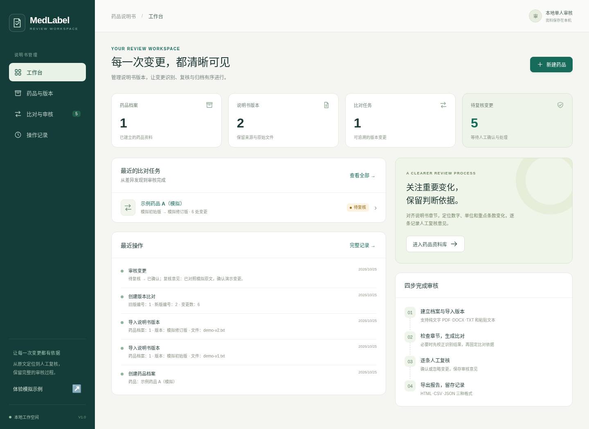
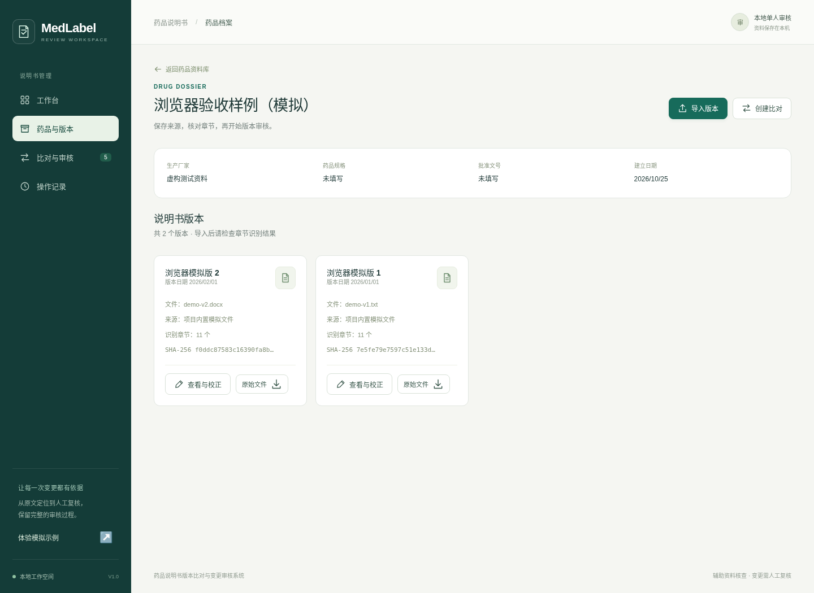
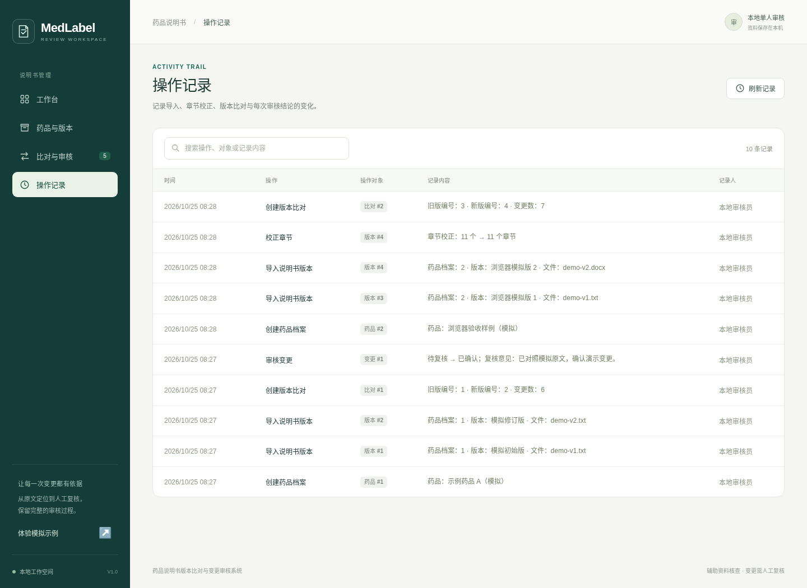

# 药品说明书版本比对与变更审核系统 V1.0

## 用户操作手册

英文项目名：MedLabel Review。本文与仓库中的实际程序一起维护；以下截图来自真实运行的 V1.0 界面，所展示资料均为模拟数据。

### 1. 使用范围

本系统帮助整理药品说明书版本，定位章节内容变化，记录人工审核意见，并导出审核报告。适合个人学习、毕业设计及受控的资料核对演示。

系统采用本地单操作员模式。审核员名称是记录用的显示名称，不是经过身份认证的账号，也不是电子签名。运行方式、依赖安装和启动命令见仓库根目录 README。默认仅监听本机地址；当前版本不提供面向互联网的账号、权限和租户隔离。

### 2. 开始使用

1. 按 README 启动服务，用浏览器打开本机页面。
2. 首次使用可加载模拟示例，熟悉版本比对与审核流程。模拟药品、说明书和变更均用于演示，不得用于临床。
3. 也可以直接新建自己的药品档案，再导入合法取得的说明书。

重复加载模拟示例不会作为新业务反复生成同一份演示数据。示例的审核状态可能保留上次操作结果；不应将其当作固定评测数据。

### 3. 建立药品档案

进入“药品与版本”，填写名称、厂家、规格、批准文号及备注。将同一药品的不同版本放在同一档案下；不同规格或厂家需要单独核对时，建议建立不同档案。

这些字段由使用者维护。系统不会向监管数据库验证批准文号，也不会仅凭药品名称判断不同文件是否属于同一注册产品。

### 4. 导入说明书版本

填写版本标签、版本日期和来源。来源建议记录发布机构、网址或内部文件编号，便于日后回查。

支持两种输入方式：

- 文件上传：纯文字 PDF（不含图片）、DOCX，以及 UTF-8 或 GB18030 编码的 TXT。单个文件上限为 10 MB，PDF 最多 100 页；应用接受的提取正文不超过 30 万字符。
- 文本录入：粘贴说明书正文，作为独立版本保存。

上传后检查提取正文和章节。系统保留原始资料及内容摘要，用于后续核查来源；摘要只能用于识别文件内容是否相同，不能证明来源真实或文件获得监管核准。

扫描 PDF、图片、旧版 DOC 和依赖 OCR 才能读取的资料不在首版支持范围内。首版保守拒绝含图片的 PDF，包括扫描正文同时带可提取页码、图片页眉或标志的情况，避免静默遗漏。含未处理修订、脚注或尾注的 DOCX 需先处理或转成完整文本。遇到此类文件，应先通过合适工具转换为完整 TXT / DOCX，再逐项核对后导入。

### 5. 检查和校正章节

章节识别依据标题与文本结构。常见标题包括药品名称、适应症、用法用量、禁忌、不良反应和注意事项等。不同文件的排版、表格和标题习惯可能影响提取结果。

校正时重点检查：

- 是否将正文中的括号误认为标题。
- 是否遗漏页间内容、表格文字或页眉页脚。
- 数字、小数点、单位及否定词是否与原文件一致。
- 同名章节是否保留，内容是否被划分到正确章节。

在该版本首次参与比对前，可以校正章节标题和正文。校正记录不会覆盖原始文本。版本已经参与比对后，系统拒绝继续修改其章节，以保证已有比对结果可回查；需要调整时，应重新建立一个版本。

### 6. 创建版本比对

选取同一药品档案中的旧版本和新版本。两个版本必须不同，旧版本日期不得晚于新版本日期。

在“比对与审核”中，系统按章节生成新增、删除、修改三类变化，统计未改变的章节。同名重复章节按出现顺序配对并提示人工核对；仅调整章节顺序会提示，但不单列为正文变更。重点章节及数字、单位等变化会出现复核提示。该提示只是文本核查优先级，不是药品风险等级、临床结论或监管认定。

首次检查建议先确认整份文件的章节完整性，再逐条查看差异。原文位置中的“行”是提取后文本的行号，不等同于 PDF 页面行号；经过手工校正的章节会采用相应的校正位置标识。

### 7. 审核每条变化

每条变化包含旧文、新文、差异提示和审核状态：

| 状态 | 使用方式 |
| --- | --- |
| 待复核 | 尚未完成人工判断，或需要重新核查 |
| 已确认 | 已核对原始资料，确认这是一项需要记录的变化 |
| 已忽略 | 经核对决定不纳入本次审核关注范围，必须填写原因 |

审核意见应说明核查依据及处理原因。例如：“核对原件后确认仅为空格排版差异。”不得用“已确认”表示药品安全性、有效性或监管合规已获批准。

保存时，系统记录显示名称、时间及意见。若另一个浏览器标签页已更新同一条变化，旧页面保存会提示冲突；刷新记录后再提交，避免覆盖较新的审核结果。

### 8. 导出结果

比对记录支持 HTML、CSV、JSON 导出：

- HTML：可独立打开的报告，适合查阅、打印和通过浏览器另存为 PDF。
- CSV：适合在电子表格中继续整理；保留中文编码及防公式执行处理。
- JSON：适合程序处理或保存结构化结果。

报告应连同原始版本资料一起保存。导出时仍有待复核变化的，报告反映的是当前审核进度，不应作为已经完成的审核结论。

### 9. 查看操作记录与备份

“操作记录”用于回查档案、版本、比对和审核相关操作。当前版本的日志存放于本地数据库，不具备外部可信时间戳或防管理员篡改能力。

备份前停止服务，完整复制 README 指定的数据目录，包括数据库和原始附件。默认目录是启动工作目录下的 `data/`，也可通过 `MEDLABEL_DATA_DIR` 指定；其中数据库为 `medlabel.sqlite3`，原始附件位于 `uploads/`。恢复时同样在停服状态下操作，保留目录内部结构。仅复制导出报告不能恢复全部业务数据。

### 10. 常见问题

| 现象 | 处理办法 |
| --- | --- |
| PDF 无法提取文字 | 检查是否为扫描件、加密或损坏文件；必要时人工整理文本 |
| 章节识别不正确 | 在创建比对前校正章节，并对照原始文件核验 |
| 同一版本无法再次修改章节 | 它已参与比对；以新版本重新导入更正资料 |
| 创建比对失败 | 检查两个版本是否属于同一档案、是否选中同一版本，以及版本日期顺序 |
| 忽略变更时无法保存 | 补充忽略原因 |
| 保存提示冲突 | 刷新最新审核记录，再确认是否需要修改 |
| 文字没有变化但仍有提示 | 检查数字、单位、标题、空白排版及提取错误 |
