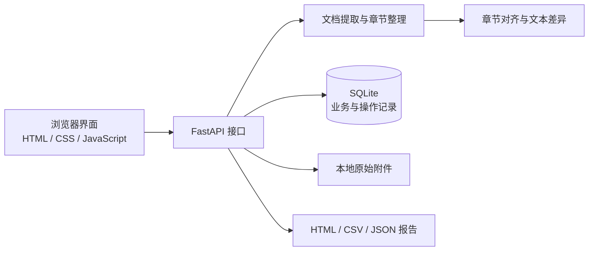
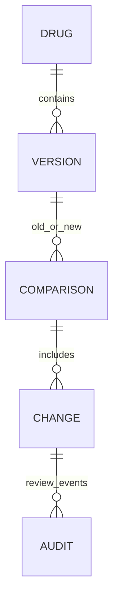

# 药品说明书版本比对与变更审核系统 V1.0

## 软件设计说明书

### 1. 设计目标与边界

MedLabel Review 将“说明书资料归档—章节整理—版本比对—人工审核—报告导出”串联为可复查的工作流程。首版以单机运行和单个可信操作员为目标，支持没有外部模型服务或医院接口的离线业务处理。

功能重点是文档核对，程序不判断用药方案是否正确，不代替药师、注册人员或监管机构作出结论。当前版本不提供 OCR、真实身份认证、电子签章、联网说明书真实性校验或多租户隔离。

### 2. 系统结构

前端由服务端直接提供静态文件，不需要额外的前端构建服务。后端使用 Python 和 FastAPI，业务数据保存在 SQLite，原始附件保存在配置的数据目录中。`MEDLABEL_DATA_DIR` 控制数据目录，`MEDLABEL_REVIEWER` 控制审核员显示名称。

### 3. 模块职责

| 模块 | 文件 | 职责 |
| --- | --- | --- |
| 接口与应用入口 | `app/main.py` | 请求校验、接口编排、静态页面、上传与下载 |
| 数据访问 | `app/database.py` | 数据库初始化、业务持久化与操作记录 |
| 文档处理 | `app/documents.py` | TXT / PDF / DOCX 提取、章节识别与校正 |
| 差异计算 | `app/comparison.py` | 章节匹配、增删改识别、字符差异和复核提示 |
| 报告输出 | `app/reports.py` | HTML、CSV、JSON 导出 |
| 演示数据 | `app/demo.py` | 明确标识为模拟的示例资料 |
| 用户界面 | `app/static/` | 药品、版本、比对审核及操作日志交互 |

以上是文件职责说明；具体函数与字段以同版本源代码为准。

### 4. 核心数据关系

| 对象 | 关键内容 |
| --- | --- |
| 药品档案 | 名称、厂家、规格、批准文号、备注 |
| 说明书版本 | 所属药品、版本标签、日期、来源、原始文件名、SHA-256、提取文本、结构化章节 |
| 版本比对 | 旧版与新版标识、创建时间、差异及未变化统计 |
| 章节变化 | 章节键与名称、增删改类别、原文、新文、位置、提示、审核状态 |
| 审核信息 | 意见、审核员显示名称、时间、修订号 |
| 操作记录 | 动作、关联实体、详情、操作者显示名称、时间 |

ER 图表达逻辑关系，并不声明每个对象都使用独立数据库表。

### 5. 文档处理设计

1. 校验文件类型、大小与解析限制。
2. TXT 按受支持编码解码；PDF 提取文字层；DOCX 提取文档内容。
3. 将常见章节标题映射为稳定的章节键；重复章节保留次序，不直接覆盖。
4. 保留不能识别为标准章节的文本，避免只输出已识别的章节。
5. 保存原文以及结构化章节。使用者可在版本参与比对之前校正章节。

文件摘要用于内容追踪。PDF 的提取行号不表示版面坐标，表格或复杂排版需人工核验。首版保守拒绝含图片的 PDF（含嵌套 Form XObject 和内联图片），防止正文为扫描图像但页码可提取时出现静默丢失。空文档和不支持的格式返回可理解的错误信息。

### 6. 差异计算设计

章节比对采用确定性的标题规范化和文本比较，不依赖大模型推测含义。相同章节键进行对齐，只有新版存在的章节为新增，只有旧版存在的章节为删除，正文发生变化的章节为修改。

差异片段区分相同、删除、插入，供前端高亮。数字、剂量单位和重点章节变化用于提示优先核对；规则不能识别全部药学语义变化，也不能证明未出现提示的内容不重要。

重复标题按出现顺序匹配，系统会给出复核提示；章节顺序变化本身会作为提示，而不被计为正文变更。超长章节采用整段增删展示以限制字符匹配消耗。重复标题、无标准标题和文件提取误差可能影响匹配质量。用户应先检查章节结构，再利用比对结果辅助审核。

### 7. 审核一致性设计

- 比对仅允许同一药品的两个不同版本，且旧版日期不得晚于新版。
- 一旦版本被用于比对，其章节停止允许修改；更正资料应生成新版本。
- 变化状态为待复核、已确认、已忽略；忽略必须填写原因。
- 更新携带修订号。修订号不一致时拒绝覆盖，提示客户端刷新，防止多个标签页相互覆盖。
- 状态更新和关联操作记录应在同一事务中完成。

### 8. 接口概览

| 方法 | 路径 | 用途 |
| --- | --- | --- |
| GET | `/api/dashboard` | 总览统计 |
| GET / POST | `/api/drugs` | 查询、建立药品档案 |
| GET / POST | `/api/drugs/{id}/versions` | 列出版本、上传文件 |
| POST | `/api/drugs/{id}/versions/text` | 录入文本版本 |
| GET | `/api/versions/{id}` | 读取版本与章节 |
| PUT | `/api/versions/{id}/sections` | 在允许阶段校正章节 |
| GET | `/api/versions/{id}/file` | 下载原始文件 |
| GET / POST | `/api/comparisons` | 查询、创建比对 |
| GET | `/api/comparisons/{id}` | 获取完整比对结果 |
| PATCH | `/api/changes/{id}` | 保存审核意见与状态 |
| GET | `/api/comparisons/{id}/export` | 导出报告 |
| GET | `/api/audit` | 查看操作记录 |
| POST | `/api/demo` | 加载模拟示例 |

### 9. 输入与输出防护

系统默认绑定本机地址。浏览器写请求要求自定义请求头，配合不开放跨域访问的配置减少跨站请求风险。该机制不是账号认证，不能代替正式的网络访问控制。

上传限制及文档解压限制用于减少异常文件资源消耗。上传文件不作为可执行代码运行。展示及 HTML 报告转义用户文本，CSV 输出对可能被表格程序解释为公式的单元格作处理。

本地数据库和附件仍需要操作系统权限及备份保护。当前日志不是不可篡改审计链，不能等同于符合药品行业全部验证要求的商业系统。

### 10. 测试与维护

核心验证包括章节识别、重复标题、数字单位差异、章节增删、格式错误、版本归属与日期校验、审核冲突、导出转义等。具体已执行测试及结果以仓库测试文件和 README 为准，不在本文预先填写通过率。

维护时应同时更新代码、操作手册及示例。改变章节键生成规则或差异算法时，需要评估历史比对记录的兼容性；已有审核结果不应在后台静默重算。
